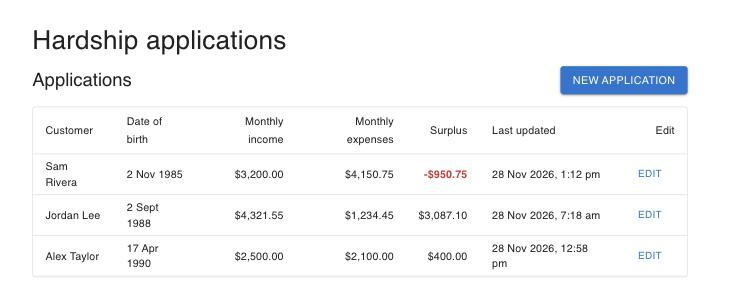
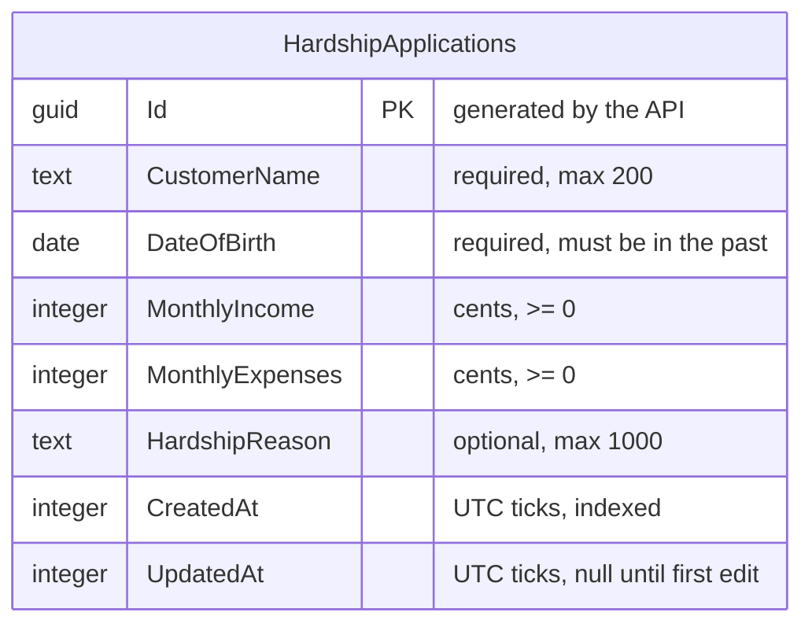

# Hardship Application System

[](https://github.com/Brady-Zhang/hardship-application-system/actions/workflows/ci.yml)

A small full-stack application for recording and updating financial hardship
applications: a React/TypeScript front end, an ASP.NET Core Web API, and a
relational database.



Submitting an application, editing one, and listing them all. The surplus is computed by the
server, and a deficit is marked — in red, and in words for anyone who cannot see the colour.

## Prerequisites

- [.NET SDK 10](https://dotnet.microsoft.com/download) (`dotnet --version`)
- [Node.js 22+](https://nodejs.org) (`node --version`) — CI runs 24

Nothing else — no Docker, no database server to install. See
[Design decisions](#design-decisions) for why.

## Running it

Two terminals.

```bash
# 1. API — http://localhost:5180
dotnet run --project src/HardshipApp.Api
```

```bash
# 2. Web — http://localhost:5173
cd web
npm install
npm run dev
```

Then open <http://localhost:5173>. The database file is created and migrated on the API's
first start, so there is no setup step between cloning and using the application.

To exercise the API on its own, open <http://localhost:5180/scalar> — an API reference that
sends real requests from the browser, so there is no need for curl or a REST client. It is
mapped in development only, next to the OpenAPI document it reads
(<http://localhost:5180/openapi/v1.json>), so the page can never describe anything the API
does not actually serve.

The Vite dev server proxies `/api` to the API, so the browser only ever talks to
one origin and CORS never enters the picture.

## Running the tests

```bash
dotnet test                                      # everything
dotnet test tests/HardshipApp.UnitTests          # fast, no database
dotnet test tests/HardshipApp.IntegrationTests   # the API over a real database
```

The test projects are split by **kind of test**, not by which project they cover:
the unit tests run in milliseconds with no infrastructure, the integration tests
stand up the API and a real database. Naming them after the production project
would have hidden that difference behind `*.Tests`.

```bash
cd web
npm run typecheck              # tsc, no emit
npm run lint                   # oxlint
npm test                       # Vitest + React Testing Library
```

73 tests in total: 21 unit, 22 integration, 30 in the browser suite. CI runs all of them on
every push and pull request.

The test the brief asked for — **a hardship record can be successfully added** — is
`Post_WithValidApplication_ReturnsCreatedAndPersistsRecord` in
[`CreateApplicationTests`](tests/HardshipApp.IntegrationTests/Api/CreateApplicationTests.cs).
It goes through the real HTTP pipeline and then reads the record back out of the database,
rather than asserting on a mocked service.

## Project structure

```
src/
  HardshipApp.Models/         entities and domain types     (no dependencies)
  HardshipApp.Repositories/   EF Core DbContext, data access  → Models
  HardshipApp.Services/       business rules                  → Models, Repositories
  HardshipApp.Api/            controllers, DTOs, validation, error handling → all of the above
tests/
  HardshipApp.UnitTests/        business rules, validators, mapping — no I/O
  HardshipApp.IntegrationTests/ the API end to end, over a real database
web/
  src/api/                    the generated contract and a typed client
  src/components/             the dialog shell, the error boundary, query states, inputs
  src/features/applications/  the list, the two form dialogs, their schema and data hooks
  src/test/                   render helpers and fixtures
```

The layering is enforced by project references rather than by convention:
`HardshipApp.Repositories` cannot reference `HardshipApp.Api`, so the dependency
direction cannot rot as the code grows.

## API

| | |
|---|---|
| `GET /api/applications` | every application, newest first |
| `GET /api/applications/{id}` | one application, or 404 |
| `POST /api/applications` | creates one; 201 with a `Location` header |
| `PUT /api/applications/{id}` | replaces one, or 404 |

`POST` and `PUT` take the same body, and there is one request type and one validator behind
both: the fields a caller may set are identical today. They split the day they differ —
until then two near-identical records would be two places to change a rule and one place to
forget.

The response carries `monthlySurplus` and `isInDeficit` alongside the figures they come from,
so the number on screen is the one the server computed rather than one the browser worked
out again.

All four are listed in the [Scalar reference](#running-it) when the API is running, with a
request builder next to each one.

## Type safety across the stack

There is one definition of the contract, and it is the C# one.

```
C# DTOs  →  openapi/HardshipApp.Api.json  →  web/src/api/schema.d.ts  →  the client and the UI
            (written on build)               (npm run api:types)
```

Nothing in `web` hand-writes an API type. Change a DTO and the TypeScript either compiles
against the new shape or fails to compile.

Three things hold that up rather than relying on anyone remembering:

- **The document is written on build** (`OpenApiGenerateDocumentsOnBuild`), so it cannot be a
  stale file somebody exported once.
- **CI regenerates and diffs.** The `contract` job builds the API, regenerates the types and
  fails if either file differs from what was committed — so a DTO change that skipped
  regeneration cannot merge.
- **`tsc` runs in CI** with `strict` on, so a shape change surfaces at the call sites.

Regenerate locally with:

```bash
dotnet build src/HardshipApp.Api
cd web && npm run api:types
```

## Error handling

Every failure comes back as RFC 7807 problem details, and a 400 has the same shape whether
the request failed business validation or could not be deserialised at all:

```json
{
  "type": "https://tools.ietf.org/html/rfc9110#section-15.5.1",
  "title": "One or more validation errors occurred.",
  "status": 400,
  "errors": { "CustomerName": ["Customer name is required."] },
  "traceId": "00-0e0a67ff517932bf5cb50d43817550ef-12cb32c6a2a71eee-00"
}
```

That matters for the front end, which maps `errors` onto form fields and needs one contract
rather than two. Four things are deliberate:

- **Field names are normalised twice.** The JSON binder reports `$.dateOfBirth` and the
  validators report `DateOfBirth`, so the API answers `DateOfBirth` either way; the web
  client then lowercases the first letter once, centrally, so the form deals only in its own
  field names.
- **Serialiser messages never reach the caller.** The binder's own text names the .NET type
  it failed to construct, which is an internal detail and no help to whoever filled in the
  form. It is replaced with a readable sentence, and there is a test asserting the response
  contains no internal names.
- **The framework's own responses are problem details too** (`UseStatusCodePages`). An
  unknown path or a route constraint that did not match is answered before any of our code
  runs, and used to come back as a 404 with an empty body — which a client can only report
  as "something went wrong".
- **An unhandled exception** is logged in full and returned as a 500 problem details with
  nothing specific in it. A test asserts the body carries no exception message, no type name
  and no stack frames.

In the browser, a failure lands in one of three places, depending on what the user can do
about it:

| | |
|---|---|
| a field the server rejected | on that field, via Formik's `setErrors` |
| a failure belonging to no field | above the form, and the form keeps what was typed |
| a page that could not load | in place, with Retry — except a 404, which will not change |

A render that throws is caught by an error boundary rather than leaving a blank page. It is
keyed by the path, so navigating away from a broken page is enough to recover. A list that
fails to *refresh* keeps the rows it already has and shows the message above them.

## Data model



`MonthlySurplus` (income less expenses) is derived in the domain rather than stored, so it
cannot fall out of step with the two figures it comes from.

**One table, deliberately.** Splitting the customer into their own entity needs a rule for
deciding when two applications belong to the same person, and the brief gives no identifier
to decide it by — no email, no customer number, and two applicants can share a name. Adding
a status or an approval record would mean tables nothing in the brief writes to. Both are
listed under [what I would add for production](#what-id-add-for-production) instead, where
they cost nothing to maintain.

## Assumptions

Where the brief left room, this is what I decided and why.

- **Anyone can use it.** There is no login, and every caller sees every application. Adding
  authentication without knowing who the users are — customers, or staff acting for them —
  would have meant inventing a model rather than building one.
- **An applicant is an adult.** Date of birth must be in the past and at least 18 years ago.
  A hardship arrangement is a financial agreement, so this seemed safer than accepting any
  past date.
- **Income and expenses are monthly, in AUD, and may be zero.** The brief says "income" and
  "expenses" without a period; the form labels say which, so nobody has to guess.
- **Expenses above income are expected.** A deficit is the situation being reported, not a
  mistake, so nothing rejects it — there is a test that says so.
- **"Update" means replace.** `PUT` takes the whole record; there is no partial update,
  because the form always holds every field anyway.
- **Nothing is deleted.** The brief asks for create, update and list. A hardship application
  is a record of something somebody said, so removing one looked like a decision for the
  business rather than a gap to fill.
- **The list is complete and unpaged**, newest first. See the production list below.

## Design decisions

- **SQLite, through EF Core.** The brief allows any relational database, and the provider is
  one line in `AddPersistence`. SQLite means a reviewer needs no server, no container and no
  connection string — `dotnet run` and the database is there. Nothing in the data access is
  SQLite-specific beyond the two converters below.
- **Money is stored as a whole number of cents.** SQLite has no decimal type; left alone,
  EF Core stores a `decimal` as TEXT, where `'900.00'` sorts before `'90.00'` and comparisons
  are unreliable. An integer column keeps arithmetic exact and keeps ordering and range
  filters correct in SQL. The domain still speaks `decimal` — a value converter sits between.
- **Timestamps are stored as UTC ticks**, for the same reason: SQLite refuses to order by a
  `DateTimeOffset` at all. Storing a `DateTime` instead would sort, but it comes back as
  `DateTimeKind.Unspecified`, serialises without a `Z`, and is then read by the browser as
  local time — a bug worth designing out rather than remembering.
- **A deficit is a valid application, not a validation error.** An applicant whose expenses
  exceed their income is describing the exact situation hardship assistance exists for.
  Nothing in the stack rejects it, and there is a test that says so.
- **`CreatedAt` and `UpdatedAt` are set in `SaveChanges`, not by callers.** The second write
  path is the one that forgets. `CreatedAt` is explicitly held back from updates so it cannot
  be rewritten. The clock is injected, so tests assert an exact instant rather than a
  tolerance.
- **MUI, with the stock theme.** The brief invited a pre-styled component library and asked
  to keep it simple, so there is no custom theme, no layout chrome and no icon set — just the
  components the screens need.
- **One form component for create and edit.** They differ by initial values and a button
  label. The edit dialog mounts it only once the record has arrived, so it never renders
  empty and then fills itself in — the usual way an edit form ends up permanently blank —
  and `enableReinitialize` covers the values changing underneath it after a save.
- **Both forms are dialogs, and both are still routes.** `/applications/new` and
  `/applications/:id/edit` render over the list rather than replacing it, so the surrounding
  records stay in view while someone types. Keeping them as routes rather than a piece of
  component state is what makes a link to an application shareable, and makes Escape, Cancel
  and the browser's Back button all mean the same thing: go back to the list.
- **The dialog's buttons sit outside the form.** They are in `DialogActions`, pinned to the
  bottom, and reach the form through the HTML `form` attribute — the pattern MUI documents —
  so they cannot scroll out of reach on a short screen. Their disabled state comes from the
  mutation's own `isPending` rather than a second copy of "is it saving".
- **Form values are held as strings and converted on submit.** A number input bound to a
  numeric field carries `NaN` the moment it is cleared, and the date input hands back the
  `yyyy-MM-dd` string the API already wants.
- **Validation is written twice, on purpose.** Yup in the browser so the form answers
  immediately, FluentValidation on the server because the browser's copy is advice, not
  enforcement. The server's answer is mapped back onto the individual fields.
- **Server state lives in React Query, and there is no store.** Everything on screen is a
  copy of something the API owns; a store would be a second copy to keep in step. The one
  piece of client state — the "saved" message — travels in the history entry, so it cannot
  outlive the navigation that caused it.
- **No generic `IRepository<T>`.** A generic repository over EF Core mostly restates what
  `DbSet` already is. The repository exposes named operations instead.
- **Migrations run at start-up** so a fresh clone works with one command. That is the right
  trade-off for a reviewer and the wrong one in production, where several instances starting
  at once would race and a failed migration should fail the deployment rather than the app.
- **The frontend's API types are generated from the API's OpenAPI document**, not
  hand-written, so the contract exists once. See
  [type safety across the stack](#type-safety-across-the-stack).
- **An API reference page (Scalar), in development only.** It reads the same OpenAPI
  document the client's types come from, so there is one description of the API rather than
  a second one to keep in step — and it sends real requests, which makes trying an endpoint
  a click rather than a curl command. It is not mapped outside development: it is a tool for
  whoever is working on the code, not a public page.
- **A `decimal` is described as a plain JSON number.** ASP.NET's default schema for one is
  `["number", "string"]`, because the serialiser will *read* a decimal from a quoted string.
  It never writes one, so the union was inaccurate for every response and turned every money
  field in the generated client into `number | string`. A schema transformer corrects it.
- **Warnings are errors in CI** (`-warnaserror`, `tsc`, `oxlint`). An unused
  variable or a nullable violation should not need a review comment.
- **TypeScript is pinned to 5.x** in `web`: `openapi-typescript` currently peers on
  `typescript@^5`, and the generated contract matters more than being on the newest
  compiler.
- **The vulnerable transitive `Microsoft.OpenApi` the project template pulled in is
  pinned forward** to a patched version — the template ships 2.0.0, which carries a
  known high-severity advisory.

## What I'd add for production

Out of scope for the brief, and left out on purpose rather than forgotten.

- **Authentication and authorisation.** Hardship applications are sensitive personal and
  financial data; nothing here is behind a login.
- **An audit trail** — who changed what, and when. `UpdatedAt` says a record changed, not who
  changed it or what it said before, which is not enough in a regulated setting.
- **A server-backed database** — SQL Server, say — once more than one instance needs to write
  at a time. The provider changes in one place; the two value converters would be dropped.
- **A separate applicant entity**, once there is a stable identifier to match people by, so
  one person's repeat applications hang together.
- **A status and an approval record**, once there is a decision step for them to describe.
- **Optimistic concurrency** (`rowversion`), since two staff can open the same application.
- **Pagination** on the list endpoint. It returns everything today, which is fine for a
  handful of records and not fine later.
- **Structured logging and tracing** to somewhere a person reads. Failures are logged with
  the trace id that the problem details already return, which only helps if the logs are
  searchable.
- **Migrations as a deployment step** rather than at start-up.
